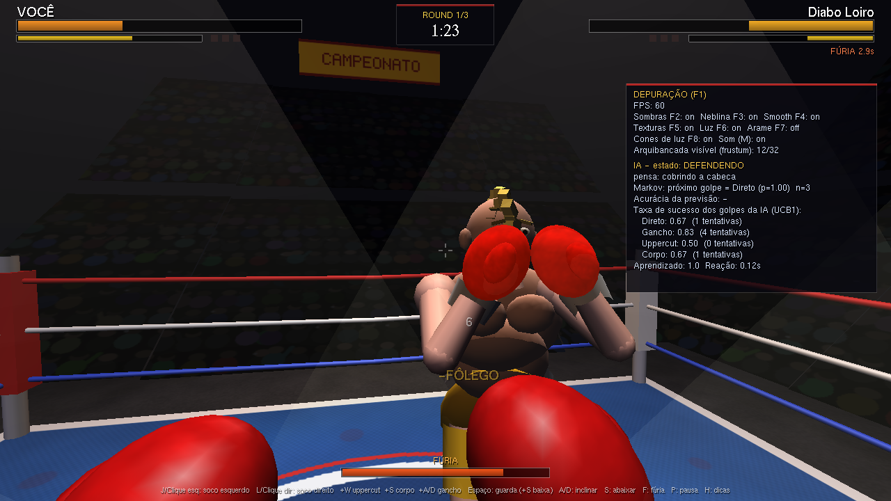

# Punch Club 3D

**Trabalho Final de Computação Gráfica:** jogo de boxe em **primeira pessoa**, feito em C++ com OpenGL e GLUT.

A inspiração vem de dois jogos:

- **Punch Club**: gerenciamento de carreira. Você treina Força, Agilidade e Resistência, trabalha, come, dorme e enfrenta uma escada de 5 adversários. Os atributos não treinados caem com o tempo.
- **Wii Sports Boxing**: a luta em si. Os socos são esquerdo e direito, e a postura escolhe o golpe. A defesa usa guarda, esquiva lateral e abaixar.

O mundo é **3D**, mas a **jogabilidade é 2D**. O combate acontece no plano entre os dois lutadores: você inclina para os lados, abaixa e soca para frente.



---

## Como compilar e executar

### Linux (Ubuntu/Debian)
```bash
sudo apt install g++ make freeglut3-dev
make
./punchclub3d
```

### Windows (MSYS2 / MinGW, recomendado)
```bash
pacman -S mingw-w64-x86_64-gcc mingw-w64-x86_64-freeglut make
make
./punchclub3d.exe
```

### Windows (Visual Studio / CLion com CMake + vcpkg)
```bash
vcpkg install freeglut
cmake -B build -DCMAKE_TOOLCHAIN_FILE=<vcpkg>/scripts/buildsystems/vcpkg.cmake
cmake --build build --config Release
```

### macOS
`make` (usa o GLUT e o OpenGL do sistema).

- Para compilar **sem áudio**, use `make NO_AUDIO=1`.
- `make test` roda o teste automático de colisões, que não precisa de janela.

---

## Controles

| Ação | Tecla |
|---|---|
| Soco esquerdo / direito | **J** / **L** (ou clique esquerdo / direito) |
| Direto | soco parado |
| Gancho | segurar **A** ou **D** + soco |
| Uppercut | segurar **W** + soco |
| Golpe no corpo | segurar **S** + soco |
| Guarda alta / baixa | **Espaço** / **Espaço + S** |
| Inclinar (esquiva lateral) | **A** / **D** |
| Abaixar | **S** |
| Fúria | **F** (quando a barra enche) |
| Pausa | **P** ou **ESC** (Q sai) |
| Dicas na tela | **H** |
| Som liga/desliga | **M** |

**Teclas para a apresentação dos recursos gráficos**

| Tecla | Recurso |
|---|---|
| **F1** | painel de depuração (FPS, estado da IA, previsão de Markov, culling) |
| **F2** | sombras planares liga/desliga |
| **F3** | neblina liga/desliga |
| **F4** | sombreamento suave (Gouraud) ou flat |
| **F5** | texturas liga/desliga |
| **F6** | iluminação liga/desliga |
| **F7** | modo aramado (wireframe) |
| **F8** | cones de luz liga/desliga |
| **F9** | modo PS1 liga/desliga (cena 3D em 240 linhas ampliada com `GL_NEAREST`, sombreamento flat, sem especular) |

---

## Mecânicas

### Golpes e defesa (com detecção de colisões real)
Cada golpe tem **preparo, extensão e recolhimento**. Durante o preparo, a luva do adversário **brilha com a cor do golpe**: branco para direto, amarelo para gancho, vermelho para uppercut e azul para golpe no corpo. O golpe é lançado na direção onde você **estava quando o preparo começou**. Se você sair da linha a tempo, ele passa direto.

A tabela abaixo foi gerada pelo teste automático (`make test`), que simula cada golpe contra cada postura usando as esferas de colisão:

| Golpe | parado | guarda alta | guarda baixa | inclinar | abaixar |
|---|---|---|---|---|---|
| Direto | acerta | **bloqueia** | acerta | **esquiva** | **esquiva** |
| Gancho | acerta | **bloqueia** | acerta | **esquiva** | **esquiva** |
| Uppercut | acerta | **bloqueia** (gasta muito fôlego) | acerta | **esquiva** | acerta o peito |
| Corpo | acerta | acerta | **bloqueia** | acerta | acerta |

### Mecânicas novas (que não existem nos jogos originais)
- **Contra-ataque:** se você esquivar de um golpe, abre uma janela de 0,7 s. Socos lançados nessa janela causam **x1,6** de dano. A mira fica amarela para avisar.
- **Aparar (bloqueio perfeito):** levantar a guarda menos de 0,18 s antes do impacto deixa o atacante atordoado.
- **Exposição:** quem erra um soco fica exposto e leva **x1,25** de dano.
- **Fôlego:** socos, esquivas e guarda gastam fôlego. Sem fôlego, os socos ficam lentos e fracos, e a guarda **quebra**. Golpes no corpo também atrapalham a recuperação do fôlego.
- **Fúria:** a barra enche quando você acerta e esquiva. Ao ativar, o adversário entra em **câmera lenta** e seus golpes causam x1,5.
- **Knockdown:** para levantar antes do 10, alterne **J** e **L**. Três quedas resultam em nocaute técnico. Se ninguém cair, a luta vai a 3 rounds de 90 s e termina na decisão por pontos.
- **Fintas:** os adversários mais fortes fingem o soco para te fazer esquivar e depois batem onde você foi.

### Carreira (estilo Punch Club)
Na academia, a cada dia você escolhe o que fazer:

- **Treinar Força:** mini-jogo do **saco de pancadas**. O saco é um pêndulo com física, e acertar quando ele volta na sua direção vale mais.
- **Treinar Agilidade:** mini-jogo das **manoplas**. É preciso acertar a manopla acesa com o golpe pedido e esquivar dos ataques do treinador.
- **Treinar Resistência:** mini-jogo de **corrida** em uma rua 3D, apertando A e D no ritmo do metrônomo.
- Trabalhar (dinheiro), comer (energia), dormir (passa o dia; os atributos não treinados caem) e lutar.

O ganho de cada treino diminui conforme o atributo sobe. O jogo é salvo automaticamente em `punchclub3d_save.txt`.

---

## Requisitos do trabalho → onde estão no código

| Requisito | Implementação | Arquivo |
|---|---|---|
| **Jogo 3D com jogabilidade 2D em janela GLUT** | Câmera em primeira pessoa e combate no plano entre os lutadores | `main.cpp`, `Game.cpp` |
| **Detecção de colisões** | Esferas para cabeça, tronco, luvas e antebraços. Detecção **contínua** (*swept sphere*: segmento do movimento da luva x esfera, soma de Minkowski), que evita o "tunelamento" com socos rápidos. Colisão também com o saco de pancadas e com as manoplas | `Collision.h`, `Combat.cpp` |
| **Inteligência Artificial** | **Máquina de estados** (Neutro, Atacando, Defendendo, Recuperando, Atordoado, Caído). **Percepção com tempo de reação** e leitura do golpe. **Cadeia de Markov** que prevê o próximo golpe do jogador e antecipa a defesa. **UCB1 (bandido multi-braços)** para escolher os golpes que funcionam contra você. Detecção do hábito de contra-atacar. 5 personalidades diferentes | `AI.cpp` |
| **Iluminação** | Holofote (spotlight) com atenuação, luz direcional de preenchimento, contra-luz pontual e **flashes de câmera** dinâmicos. Materiais com brilho especular, luz emissiva no brilho das luvas | `Scene.cpp` (`setupLights`, `mat`) |
| **Sombreamento** | Gouraud ou flat (F4). Pisos subdivididos em grade para o cone do holofote aparecer com iluminação por vértice. `GL_NORMALIZE` | `Scene.cpp` |
| **Texturas** | 10 texturas **procedurais** (lona com logotipo, saia do ringue com texto, torcida, madeira, couro, saco, asfalto, grama, faixa, concreto). Ruído fractal, fonte bitmap própria, **mipmaps** e `GL_MODULATE` | `Textures.cpp` |
| **Visibilidade** | Z-buffer, back-face culling, **descarte por frustum** da arquibancada (o F1 mostra quantas seções foram desenhadas), neblina e planos de recorte (`glClipPlane`) no cabelo | `Scene.cpp` |
| **Sombras** | Sombras planares projetadas (matriz de sombra) com **stencil buffer**: só sobre a lona, sem mistura dupla | `Scene.cpp` (`shadowMatrix`, `beginShadow`) |
| **Modelagem hierárquica / animação** | Lutadores **low-poly facetados** modelados à mão (malhas de anéis para cabeça, tronco e calção, prismas nos membros, luvas facetadas, normal por face) e montados por articulações. Marcas de machucado aparecem conforme a vida cai (hematoma, corte, olho inchado, nariz sangrando). Braços e pernas com **cinemática inversa de 2 ossos**, reação da cabeça com mola amortecida e trajetórias dos golpes por **curvas de Bézier** | `Scene.cpp`, `Fighter.cpp` |
| **Bibliotecas complementares** | **miniaudio** (áudio). Os 15 efeitos são **sintetizados em tempo de execução** (osciladores, ruído filtrado, envelopes), então não há arquivos de som | `Audio.cpp`, `third_party/miniaudio.h` |
| Transparência | Cones de luz aditivos, partículas de suor, HUD com alfa e vinhetas | `Scene.cpp`, `Hud.cpp` |

## Estrutura

```
src/
  main.cpp        janela GLUT, callbacks, laço de tempo
  Game.*          estados (menu, academia, luta, treinos), carreira, câmera, entrada
  Fighter.*       lutador: atributos, postura, máquina de estados dos golpes
  Combat.*        resolução de golpes (colisão + dano)
  Collision.h     testes de colisão (esfera x esfera, esfera varrida)
  AI.*            IA do adversário
  Scene.*         renderização 3D
  Hud.*           interface 2D em pixel art (fonte bitmap 5x7 própria com acentos, barras, telas)
  Textures.*      texturas procedurais
  Audio.*         síntese e reprodução de som
tests/combat_test.cpp   teste automático das colisões
third_party/miniaudio.h biblioteca de áudio (domínio público / MIT-0)
```

## Créditos
- miniaudio, de David Reid (domínio público / MIT-0): https://miniaud.io
- freeglut / OpenGL / GLU
